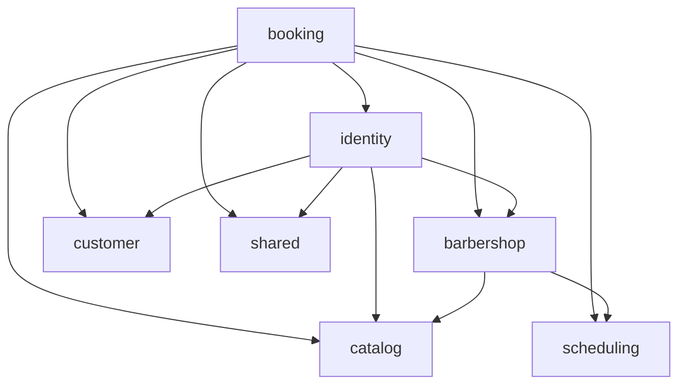

# CorteYa API — fases 1, 2 y 3

Backend multi-barbería con PostgreSQL, disponibilidad, reservas autenticadas, OTP,
JWT RS256, roles y expiración de señales. El catálogo y la disponibilidad son públicos.
La fase 3 añade únicamente Spring Security y OAuth2 Resource Server, con versiones
administradas por el BOM de Spring Boot. En Boot 4 el starter autorizado de Resource
Server se llama `spring-boot-starter-security-oauth2-resource-server`
([migración oficial](https://github.com/spring-projects/spring-boot/wiki/Spring-Boot-4.0-Migration-Guide)).

## Requisitos y versiones

Versiones estables verificadas el **19 de octubre de 2026**:

| Componente | Versión | Fuente oficial |
| --- | --- | --- |
| Java | 25 LTS | [Oracle](https://www.oracle.com/java/technologies/java-se-support-roadmap.html) |
| Spring Boot | 4.1.1 | [Spring](https://docs.spring.io/spring-boot/system-requirements.html) |
| Kotlin y plugins JVM/Spring/JPA | 2.4.21 | [Kotlin](https://kotlinlang.org/docs/releases.html) |
| Gradle Wrapper | 9.8.2 | [Gradle](https://gradle.org/releases/) |
| PostgreSQL | 18.6 | [PostgreSQL](https://www.postgresql.org/support/versioning/) |
| JUnit Jupiter | 5.14.4 | [JUnit](https://docs.junit.org/5.14.4/release-notes.html) |
| dependency-management | 1.1.7 | [Gradle Plugin Portal](https://plugins.gradle.org/plugin/io.spring.dependency-management) |
| springdoc-openapi-starter-webmvc-ui | 3.1.1 | [springdoc: versión estable y compatibilidad con Boot 4](https://springdoc.org/) |

Spring Boot administra Hibernate, Flyway, JDBC, Validation, Actuator y Testcontainers
mediante su BOM. Se mantiene JUnit 5 por requisito del proyecto; SpringExtension de
Spring 7 requiere JUnit 6, por lo que las pruebas arrancan la aplicación real con
`SpringApplicationBuilder` en los ciclos de JUnit 5. Kotlin Reflect y Jackson Kotlin
provienen del esqueleto Initializr. No se incorporaron otras bibliotecas.

## Arranque local

Necesitas JDK 25 y Docker con Compose v2 en ejecución. Desde la raíz:

```sh
cp .env.example .env
set -a
source .env
set +a
docker compose -f docker-compose.yml up -d --wait
./gradlew bootRun --args='--spring.profiles.active=dev'
```

En otra terminal:

```sh
curl --fail http://localhost:8080/actuator/health
# {"status":"UP"}
```

Abre [Swagger UI](http://localhost:8080/swagger-ui.html) para explorar y probar el contrato.
Flutter puede consumir [OpenAPI JSON](http://localhost:8080/v3/api-docs).

Compose carga `.env`; Spring recibe sus valores exportados con `source`. Si cambias
puerto, base o credenciales, ajusta también `DB_URL`, `DB_USERNAME` y `DB_PASSWORD`.
`.env` está excluido del control de versiones. PostgreSQL escucha solo en `127.0.0.1`
y conserva los datos en el volumen `postgres_data`.

```sh
docker compose -f docker-compose.yml down
```

El perfil `dev` agrega una semilla idempotente: `barberia-piloto`, tres barberos, cuatro
servicios y horarios lunes–sábado 09:00–18:00 locales; no crea clientes ni citas.
También agrega un OWNER (`3000000001`) y un BARBER (`3000000002`, asociado al primer
barbero). Son números sintéticos de desarrollo: usa el emisor de log para probarlos.
Sin `dev`, Flyway solo lee `db/migration`. Desactivar el perfil no borra datos sembrados:
usa bases separadas. Para arrancar sin semilla usa una base vacía y `./gradlew bootRun`, con las claves y WhatsApp
configurados como se indica abajo.

## Configuración de autenticación

`.env.example` incluye un pepper local para poder arrancar en `dev`. En producción
configura secretos propios y persistentes:

| Variable | Uso |
| --- | --- |
| `AUTH_OTP_PEPPER` | Secreto HMAC de al menos 32 bytes; no se persiste en PostgreSQL |
| `AUTH_OTP_SENDER` | `log` o `whatsapp`; selecciona implementación por propiedad |
| `AUTH_JWT_PRIVATE_KEY` | Llave RSA PKCS#8 PEM, mínimo 2048 bits; admite saltos reales o `\n` literales |
| `AUTH_JWT_KID` | Identificador de la llave de producción |
| `WHATSAPP_TOKEN` | Token de acceso a Meta |
| `WHATSAPP_PHONE_NUMBER_ID` | ID del emisor en Meta |
| `WHATSAPP_OTP_TEMPLATE` | Nombre de la plantilla de autenticación aprobada |
| `WHATSAPP_GRAPH_VERSION` | Versión soportada por Meta, configurada explícitamente |
| `WHATSAPP_TEMPLATE_LANGUAGE` | Idioma de plantilla, por defecto `es_CO` |

Configura explícitamente una versión soportada de Graph API en tu cuenta de Meta. El emisor envía la plantilla con parámetros de
cuerpo y botón de autenticación mediante `RestClient`, sobre HTTPS y con timeouts.
Referencia: [plantillas de autenticación de Meta](https://developers.facebook.com/docs/whatsapp/business-management-api/authentication-templates/).

En `dev` se genera una llave efímera al arrancar y el emisor por defecto es `log`.
`AUTH_OTP_SENDER=whatsapp` permite probar Meta también en dev. Elegir `log` fuera de dev
falla al iniciar: los códigos solo pueden aparecer en logs de desarrollo, con teléfono
enmascarado. Las pruebas usan un emisor en memoria y perfil test, sin envíos externos.
Fuera de dev/test se exigen PEM, `kid`, pepper y configuración de Meta; nunca hay fallback a secretos de desarrollo.

Para generar los secretos fuera del repositorio:

```sh
openssl rand -hex 32
# Usar el resultado como AUTH_OTP_PEPPER.
openssl genpkey -algorithm RSA -pkeyopt rsa_keygen_bits:2048 -out /ruta/privada/corteya-jwt.pem
# Cargar ese PEM en AUTH_JWT_PRIVATE_KEY mediante el gestor de secretos del despliegue.
```

Mantén la llave y el pepper estables entre reinicios. La llave efímera de dev invalida
los access tokens anteriores cuando se reinicia la aplicación; el cliente puede refrescar.

## Contrato HTTP v1

Todos los instantes de respuesta se muestran en ISO-8601 con offset de **America/Bogota**
(`-05:00`). La fecha de disponibilidad/agenda es local a la barbería. Dinero en COP enteros.
En Swagger usa **Authorize** con el access token para los endpoints protegidos.

| Método y ruta | Acceso / resultado |
| --- | --- |
| `POST /api/v1/auth/otp/request` | Público; `{phone}` → mensaje genérico idéntico para usuarios nuevos y existentes |
| `POST /api/v1/auth/otp/verify` | Público; `{phone, code}` → access y refresh tokens |
| `POST /api/v1/auth/refresh` | Público; `{refreshToken}` → par nuevo, revocando el refresh anterior |
| `POST /api/v1/auth/logout` | Público; `{refreshToken}` → 204, revoca su familia; idempotente |
| `GET /api/v1/me` | JWT; perfil y membresías actuales |
| `PATCH /api/v1/me` | JWT; `{name}` → 204 |
| `DELETE /api/v1/me` | JWT; 204, anonimiza cuenta y clientes, conserva citas |
| `GET /api/v1/me/appointments` | JWT; citas propias en `upcoming` y `past`, según su hora de fin |
| `GET /api/v1/barbershops/{slug}` | Público; identidad y estado de apertura |
| `GET /api/v1/barbershops/{slug}/services` | Público; servicios activos |
| `GET /api/v1/barbershops/{slug}/barbers?serviceId=UUID` | Público; barberos elegibles y `nextAvailableAt` |
| `GET /api/v1/barbershops/{slug}/availability?barberId=UUID&serviceId=UUID&date=YYYY-MM-DD` | Público; `morning` / `afternoon` |
| `POST /api/v1/barbershops/{slug}/appointments` | JWT con rol CUSTOMER; `{barberId, serviceId, startsAt}` → 201 |
| `GET /api/v1/appointments/{publicToken}` | JWT; propietario o staff de esa barbería; cualquier otro recibe 404 |
| `GET /api/v1/barbershops/{slug}/staff/agenda?date=YYYY-MM-DD` | BARBER: solo su barbero; OWNER: todos |

El OWNER puede filtrar la agenda con `barberId=UUID`. Si un BARBER solicita otro barbero,
responde 404, incluso dentro de su barbería. Un staff de otra barbería también recibe 404.
Las decisiones de pertenencia se concentran en `AuthorizationPolicy`, consultando
membresías vigentes en PostgreSQL; no basta con los roles antiguos de un JWT.
`platform_admin` se incluye en los claims, sin otorgar acceso implícito a agendas ajenas.
No hay panel de administración en esta fase.

Todos los usuarios activos tienen el rol CUSTOMER; OWNER/BARBER son capacidades
adicionales por barbería. El cuerpo de reserva **ya no recibe nombre ni teléfono**:
se obtienen de la cuenta del JWT. Sin nombre en el perfil devuelve 422. La creación
valida de nuevo el hueco, calcula precio y señal desde el catálogo y vincula el customer
de esa barbería al usuario. Después de verificar OTP se enlaza el historial de clientes
existentes que compartían ese teléfono verificado y todavía no tenían cuenta.

Ejemplo de inicio de sesión local:

```sh
curl -s http://localhost:8080/api/v1/auth/otp/request \
  -H 'Content-Type: application/json' -d '{"phone":"3001234567"}'
# Leer el código de seis dígitos en el log de dev; nunca se devuelve en la respuesta.
curl -s http://localhost:8080/api/v1/auth/otp/verify \
  -H 'Content-Type: application/json' -d '{"phone":"3001234567","code":"REEMPLAZAR"}'
# Guardar accessToken y refreshToken en el cliente, sin registrarlos en logs.
```

Con el access token, reemplaza `ACCESS_TOKEN` en Swagger o en estos comandos:

```sh
curl -i -X PATCH http://localhost:8080/api/v1/me \
  -H 'Authorization: Bearer ACCESS_TOKEN' \
  -H 'Content-Type: application/json' -d '{"name":"Cliente de prueba"}'

curl -i http://localhost:8080/api/v1/barbershops/barberia-piloto/appointments \
  -H 'Authorization: Bearer ACCESS_TOKEN' -H 'Content-Type: application/json' \
  -d '{
    "barberId":"20000000-0000-0000-0000-000000000001",
    "serviceId":"30000000-0000-0000-0000-000000000001",
    "startsAt":"2026-10-20T09:00:00-05:00"
  }'
# Cambiar la fecha para que esté dentro de la ventana de reserva actual.

curl http://localhost:8080/api/v1/me/appointments -H 'Authorization: Bearer ACCESS_TOKEN'
curl http://localhost:8080/api/v1/appointments/PUBLIC_TOKEN -H 'Authorization: Bearer ACCESS_TOKEN'
curl -i -X DELETE http://localhost:8080/api/v1/me -H 'Authorization: Bearer ACCESS_TOKEN'
```

OTP acepta celular colombiano de diez dígitos o su E.164 `+57`; normaliza antes de
contar límites. Los códigos duran cinco minutos, se guardan solo como HMAC-SHA256
ligado al desafío y teléfono, se comparan en tiempo constante y se consumen una vez.
Al quinto fallo quedan invalidados. Solo el desafío más reciente puede verificarse.
Límites: 60 segundos entre envíos, cinco por hora por número y diez por hora por IP,
contados en PostgreSQL con bloqueos transaccionales para soportar concurrencia.
Los fallos de envío también cuentan. Las respuestas 429 no revelan registro de cuenta.
Se usa la IP de la conexión; no se confía en `X-Forwarded-For` enviado por el cliente.

Access tokens: RS256, `kid`, issuer `corteya-api`, `sub`, `roles`, `memberships`,
`iat`, `nbf` y `exp`, con duración de 15 minutos y Clock UTC inyectado. Los refresh son
32 bytes aleatorios opacos (256 bits), con SHA-256 persistido, duración de 30 días y
rotación en cada uso. El reuso de uno revocado/consumido invalida toda su familia,
conservando esa revocación aunque la respuesta sea 401. Otra sesión/familia no se afecta.
Logout revoca la familia de refresh; los access ya emitidos vencen a los 15 minutos.
El borrado de cuenta sí invalida los access de inmediato mediante la comprobación de
cuenta activa durante la validación de JWT.

El borrado pone nombre `Cliente eliminado` y teléfono `NULL` en app_user y sus customers,
marca `deleted_at`, elimina membresías y revoca refresh tokens. Mantiene UUID y citas
para reportes. Una nueva cuenta con el mismo teléfono no recupera el historial anónimo.
Las reservas bloquean la fila de usuario para no recrear datos personales durante un
borrado concurrente. Se permiten customers sin cuenta para las citas MANUAL existentes.

La API es stateless: no crea sesiones HTTP, no tiene formulario ni Basic Auth.
CSRF se omite solo bajo `/api/**`. Los endpoints de cuenta, tokens y citas usan
`Cache-Control: no-store`. Los DTO con credenciales tienen representaciones de log
redactadas; no se registran tokens ni teléfonos completos.

Errores `application/problem+json` (RFC 9457), con mensajes en español: 400 datos
inválidos, 401 sesión/código inválido, 403 rol insuficiente, 404 recurso ajeno/no disponible,
409 conflicto de reserva, 422 nombre pendiente, 429 límite de OTP y 503 fallo de envío.
Nunca se exponen stack traces, códigos de error de Meta ni cuerpos del proveedor.

La apertura continúa calculándose con la unión de horarios de los barberos activos,
no con los huecos libres. Actuator solo expone `/actuator/health`; Swagger y OpenAPI
siguen disponibles para consultar el contrato.

## Arquitectura y tiempo

La aplicación usa **package-by-feature**, con siete módulos cerrados verificados por
[Spring Modulith 2.1.1](https://spring.io/projects/spring-modulith/), compatible con
Spring Boot 4.1.1. Solo se agregan los starters `core` y `test`; este último incluye
`Documenter`.

```text
com.geovannycode.corteya
├── CorteyaApplication.kt
├── barbershop/   # Identidad visual, configuración y apertura
├── catalog/      # Barberos, servicios y asignaciones
├── scheduling/   # Horarios semanales y bloqueos
├── booking/      # Disponibilidad, generador puro, citas y expiración
├── customer/     # Clientes por barbería, vinculación y anonimización
├── identity/     # OTP, JWT/refresh, cuenta /me y autorización
└── shared/       # Clock, configuración, ProblemDetail, seguridad HTTP y logging
```

Cada módulo expone sus servicios y contratos de lectura desde su paquete raíz.
Los controladores quedan planos; los DTO HTTP están en `dto/`. `internal/` contiene
entidades JPA, repositorios concretos y detalles de implementación. Ningún módulo
importa la entidad ni el repositorio de otro. Los contratos de lectura entre servicios
omiten auditoría, versión optimista y otros datos de persistencia; no son un segundo
modelo de dominio. Las proyecciones necesarias viven en el servicio dueño, sin clases
mapper ni adaptadores que envuelvan repositorios.

Hay una sola entidad por tabla JPA y repositorios concretos, sin puertos de una sola
implementación ni operaciones CRUD sin barbería. La única interfaz de estrategia es
`OtpSender`, con implementaciones Log y WhatsApp. Las consultas JDBC de OTP, locks,
clientes, reservas, expiración y retención se conservan literalmente, con los mismos
límites transaccionales. Las operaciones sobre clientes se realizan en `CustomerService`.

`SlotGenerator` permanece Kotlin puro en `booking`: calcula disponibilidad usando
estados de cita propios de ese módulo y horarios públicos de `scheduling`. Recibe
horarios, bloqueos, citas, reglas, duración, fecha, zona y ahora; no depende de Spring.
Su implementación y las aserciones/datos de las 91 pruebas originales se conservan.
El cableado de pruebas solo adapta referencias de paquetes, el nombre de la aplicación
y la herencia del doble de referencias de pago a una clase concreta.

El diagrama refleja las dependencias comprobadas por Modulith. Las flechas apuntan
al módulo proveedor de un servicio o contrato público:



`ModularityTests` ejecuta `ApplicationModules.of(CorteyaApplication::class.java).verify()`
sin exclusiones ni módulos abiertos y genera la documentación con `Documenter`. Para
regenerarla sin ejecutar los tests de PostgreSQL:

```sh
./gradlew test --tests '*ModularityTests'
```

La salida queda en `build/modulith-docs/`: `components.puml` contiene el diagrama general;
`module-*.puml` y `module-*.adoc`, los diagramas y fichas de cada módulo; `all-docs.adoc`
los reúne. La tarea `test` los genera también al ejecutar la suite completa. Son artefactos
de build, no archivos versionados. Después de `clean`, vuelve a ejecutar la prueba para
regenerarlos.

- Horarios semanales: días ISO 1=lunes a 7=domingo, `LocalTime`, intervalos dentro del día.
- Huecos cada `slot_step_minutes`, anclados al inicio de cada periodo laboral; el servicio
  debe caber completo. Se deduplican horarios superpuestos.
- Se restan bloqueos, citas `CONFIRMED` y holds pendientes vigentes. Los intervalos son
  `[inicio, fin)`: permiten citas adyacentes. Un hold es vigente en el instante exacto de
  vencimiento; se vence cuando `hold_expires_at < ahora`.
- Se excluyen el pasado y los huecos anteriores a `ahora + min_lead_minutes`.
- Ventana de N días: **hoy incluido**, hasta hoy + N − 1, en la zona de la barbería.
  Antes de 12:00 se agrupa como `morning`; desde las 12:00 como `afternoon`.
- Las zonas con cambios de horario omiten horas locales inexistentes y conservan ambos
  offsets de una hora repetida.
- Un bean `Clock` UTC controla el tiempo de negocio. No hay llamadas directas a `Instant.now()`.
  Las columnas de auditoría de JPA siguen generadas por PostgreSQL; sus valores provisionales
  en objetos nuevos son `Instant.EPOCH`, sin consultar el reloj de sistema.
- Citas/bloqueos se guardan como `Instant`/`timestamptz`; las sesiones JDBC usan UTC.
  `hibernate.type.java_time_use_direct_jdbc=true` conserva `LocalTime` sin desplazamientos
  dependientes de la zona de la JVM.

## Transacción, migraciones y expiración

La creación valida pertenencia y asignación, bloquea la cuenta activa del JWT, expira
holds vencidos de ese barbero y revalida el hueco. El upsert de cliente por `(barbershop_id, phone)` bloquea esa fila
hasta commit; la comprobación del máximo de dos `PENDING_PAYMENT` queda serializada
también si llegan solicitudes para huecos distintos. Filas vencidas de otro barbero que
siguen en `PENDING_PAYMENT` cuentan hasta que el job o una creación para ese barbero
las expire. Cualquier fallo revierte toda la transacción, incluido el upsert.

La referencia se genera como `R-` + cuatro caracteres sin `0/O/1/I`. Un conflicto de
referencia usa `ON CONFLICT` dirigido a su constraint y reintenta hasta 32 veces sin
abortar la transacción. El constraint de exclusión permanece como árbitro de concurrencia.

La señal se calcula **hacia arriba al múltiplo de COP 1.000**, con aritmética entera:
COP 38.000 × 30% → COP 12.000. V2 permite que este redondeo supere el precio de un
servicio menor de COP 1.000; no aplica un tope silencioso que altere la fórmula solicitada.

`V1__initial_schema.sql` permanece intacta. `V2__booking_availability.sql` añade reglas,
tokens únicos para citas existentes, unicidad de referencia **por barbería** e índices.
`V3__identity_and_authentication.sql` añade identidad global, OTP y refresh, membresías
por barbería y `customer.user_id`. Esas tablas globales de identidad/credenciales son
la excepción deliberada a `barbershop_id`: una cuenta puede reservar en varias barberías.
`staff_membership` sí está aislada por barbería y su FK compuesta impide asociar un
barbero de otro negocio. Clientes anonimizados admiten teléfono NULL.
Mantiene las claves foráneas compuestas, los triggers de auditoría y pertenencia y el
constraint `btree_gist` antidobles reservas. Los accesos a recursos de barbería reciben su UUID; los accesos de identidad global
reciben usuario, teléfono verificado o hash secreto. Las consultas de historial propio,
la vinculación por teléfono verificado y el borrado recorren las barberías de ese usuario.
Resolver el token público internamente siempre requiere después autorización central.
El job sigue siendo una operación global de mantenimiento.

`HoldExpirationJob` se ejecuta cada minuto con un único `UPDATE`, pasa solo pendientes
vencidos a `EXPIRED` e incrementa `version` para invalidar escrituras JPA antiguas.
Es idempotente y no modifica confirmadas. El polling devuelve el estado persistido:
un hold recién vencido puede seguir apareciendo pendiente hasta la próxima limpieza.
`booking.scheduling.enabled=false` desactiva únicamente la programación automática
para pruebas; el job se puede invocar directamente con el Clock fijado.

`OtpRetentionJob` se ejecuta diariamente a las 03:00 UTC con el `Clock` inyectado:
borra desafíos OTP vencidos hace más de 24 horas y refresh tokens vencidos o revocados
hace más de 30 días. Los límites exactos se conservan hasta la siguiente ejecución.
El borrado de cuenta elimina primero sus desafíos OTP dentro de la misma transacción
que anonimiza el teléfono. V4 agrega los índices de retención; V1–V3 no cambian.

Flyway necesita permiso para crear `btree_gist`. Hibernate usa `ddl-auto: validate`;
no cambia el esquema. No modifiques migraciones ya aplicadas: crea una nueva versión.

## Pruebas

Con Docker en ejecución, sin levantar Compose ni exportar `.env`:

```sh
./gradlew clean test bootJar
```

Testcontainers inicia PostgreSQL 18.6 aislado, con credenciales y puertos efímeros.
La suite incluye reglas y bordes del generador, migraciones desde cero y desde V1 con
datos, aislamiento, diez solicitudes HTTP concurrentes al mismo hueco (1×201, 9×409),
límite concurrente por teléfono, rollback, vencimiento sin job, job idempotente, colisiones
de referencia, redondeo, estado abierto/cerrado, siguiente día laboral, UTC ↔ Bogotá,
contrato OpenAPI, Swagger UI, login OTP completo, límites y consumo concurrentes,
JWT vencido/manipulado, rotación y reuso concurrentes, aislamiento de cliente y staff,
perfil incompleto, borrado de cuenta con reservas concurrentes, redacción de secretos,
PEM de producción y payload de Meta con `MockRestServiceServer`, además de regresiones
de las fases anteriores. Las pruebas no se omiten si falta
Docker; fallan para hacer visible el problema.

Informe: `build/reports/tests/test/index.html`. JAR ejecutable: `build/libs/corteya-api-0.0.1-SNAPSHOT.jar`.

## TODO — fases posteriores

- Fase 4: instrucciones y confirmación Bre-B/Wompi en cuentas de los barberos; webhooks.
- Row-Level Security de PostgreSQL, fuera del alcance de esta fase.
- ShedLock si se despliegan varias instancias.
- Cancelación, asistencia, notificaciones y recordatorios.
- Panel admin Vaadin, app Flutter y entrada por QR/link.
- Fase 10 (despliegue): configurar `forward-headers-strategy=native` +
  `server.tomcat.remoteip.internal-proxies` con el rango del proxy del proveedor;
  nunca confiar en `X-Forwarded-For` arbitrario. Hasta definir ese proxy,
  `server.forward-headers-strategy` permanece en `none` (modo directo seguro).
