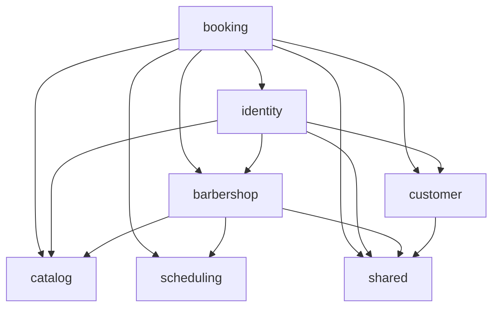

# CorteYa API — fases 1–4 y 8A

Backend multi-barbería con PostgreSQL, disponibilidad, reservas autenticadas, OTP,
JWT RS256, roles, RLS y señales por Bre-B manual o checkout Wompi. El catálogo y la disponibilidad son públicos.
La fase 3 añade únicamente Spring Security y OAuth2 Resource Server, con versiones
administradas por el BOM de Spring Boot. En Boot 4 el starter autorizado de Resource
Server se llama `spring-boot-starter-security-oauth2-resource-server`
([migración oficial](https://github.com/spring-projects/spring-boot/wiki/Spring-Boot-4.0-Migration-Guide)).

## Requisitos y versiones

Versiones estables verificadas el **19 de octubre de 2026**:

| Componente | Versión | Fuente oficial |
| --- | --- | --- |
| Java | 25 LTS | [Oracle](https://www.oracle.com/java/technologies/java-se-support-roadmap.html) |
| Spring Boot | 4.1.1 | [Spring](https://docs.spring.io/spring-boot/system-requirements.html) |
| Kotlin y plugins JVM/Spring/JPA | 2.4.21 | [Kotlin](https://kotlinlang.org/docs/releases.html) |
| Gradle Wrapper | 9.8.2 | [Gradle](https://gradle.org/releases/) |
| PostgreSQL | 18.6 | [PostgreSQL](https://www.postgresql.org/support/versioning/) |
| JUnit Jupiter | 5.14.4 | [JUnit](https://docs.junit.org/5.14.4/release-notes.html) |
| dependency-management | 1.1.7 | [Gradle Plugin Portal](https://plugins.gradle.org/plugin/io.spring.dependency-management) |
| springdoc-openapi-starter-webmvc-ui | 3.1.1 | [springdoc: versión estable y compatibilidad con Boot 4](https://springdoc.org/) |

Spring Boot administra Hibernate, Flyway, JDBC, Validation, Actuator y Testcontainers
mediante su BOM. Se mantiene JUnit 5 por requisito del proyecto; SpringExtension de
Spring 7 requiere JUnit 6, por lo que las pruebas arrancan la aplicación real con
`SpringApplicationBuilder` en los ciclos de JUnit 5. Kotlin Reflect y Jackson Kotlin
provienen del esqueleto Initializr. No se incorporaron otras bibliotecas.

## Arranque local

Necesitas JDK 25 y Docker con Compose v2 en ejecución. Desde la raíz:

```sh
cp .env.example .env
# Edita .env: define POSTGRES_PASSWORD, CORTEYA_OWNER_PASSWORD y CORTEYA_APP_PASSWORD.
# Usa contraseñas distintas; DB_PASSWORD y FLYWAY_PASSWORD referencian las anteriores.
set -a
source .env
set +a
docker compose -f docker-compose.yml up -d --wait
./gradlew bootRun --args='--spring.profiles.active=dev'
```

En otra terminal:

```sh
curl --fail http://localhost:8080/actuator/health
# {"status":"UP"}
```

Abre [Swagger UI](http://localhost:8080/swagger-ui.html) para explorar y probar el contrato.
Flutter puede consumir [OpenAPI JSON](http://localhost:8080/v3/api-docs).

Compose carga `.env`; Spring recibe sus valores exportados con `source`. Si cambias
puerto, base o credenciales, ajusta también `DB_URL`, `DB_USERNAME` y `DB_PASSWORD`.
`.env` está excluido del control de versiones. PostgreSQL escucha solo en `127.0.0.1`
y conserva los datos en el volumen `postgres_data`.

```sh
docker compose -f docker-compose.yml down
```

El perfil `dev` agrega una semilla idempotente: `barberia-piloto`, tres barberos, cuatro
servicios y horarios lunes–sábado 09:00–18:00 locales; no crea clientes ni citas.
También agrega un OWNER (`3000000001`) y un BARBER (`3000000002`, asociado al primer
barbero). Son números sintéticos de desarrollo: usa el emisor de log para probarlos.
Sin `dev`, Flyway solo lee `db/migration`. Desactivar el perfil no borra datos sembrados:
usa bases separadas. Para arrancar sin semilla usa una base vacía y `./gradlew bootRun`, con las claves y WhatsApp
configurados como se indica abajo.

## Roles y Row-Level Security (fase 3B)

`docker/postgres/01-roles.sh` crea dos roles sin superuser ni BYPASSRLS:

| Rol | Uso | Permisos |
| --- | --- | --- |
| `corteya_owner` | Solo Flyway (`spring.flyway.user/password`) | Dueño de tablas, funciones y migraciones; crea el esquema y `btree_gist`. |
| `corteya_app` | DataSource de runtime (`spring.datasource.username/password`) | USAGE del esquema/secuencias y SELECT/INSERT/UPDATE/DELETE de tablas; no ownership, CREATE ni TRUNCATE. |

Las credenciales de `.env.example` están vacías y se deben completar localmente. Los
`ALTER DEFAULT PRIVILEGES` del owner conceden los permisos anteriores a las tablas y
secuencias futuras. La app solo puede leer el historial de Flyway, no modificarlo.
El arranque rechaza credenciales de runtime que sean owner, superuser, BYPASSRLS o
miembros de `corteya_owner`.

El script de inicialización solo corre con un volumen vacío. **Una base ya existente
requiere preparación por su administrador**: crear ambos roles, transferir los objetos
de aplicación del esquema `public` (incluido `flyway_schema_history`) a `corteya_owner`
y aplicar los grants/default privileges antes de arrancar Flyway con ese rol. Mantén
los datos y un respaldo; cambiar `.env` no reejecuta el init ni cambia ownership.
No se elimina ni recrea automáticamente el volumen. Las migraciones V1–V4 se conservan
sin cambios; V5 aplica RLS y migra el directorio de identidad desde los datos existentes.

| Tablas | RLS | Comportamiento |
| --- | --- | --- |
| `barber`, `service`, `barber_service`, `working_hours`, `time_off`, `customer`, `appointment`, `barbershop_payment_settings`, `deposit_payment`, `deposit_event` | ENABLE + FORCE | USING y WITH CHECK exigen que `barbershop_id` coincida con el contexto transaccional. Sin contexto: cero filas; INSERT rechazado. |
| `barbershop` | ENABLE + FORCE | Sin contexto solo se descubren activas. Un contexto válido puede leer también su propia barbería inactiva. INSERT/UPDATE/DELETE requieren contexto igual a `id`. |
| `app_user`, `otp_challenge`, `refresh_token` | Sin RLS, identidad global | Login y credenciales aislados en código por usuario, teléfono verificado o hash secreto. |
| `staff_membership` | Sin RLS, excepción de identidad | Conserva `barbershop_id`, índice y FK compuesta; login y autorización necesitan membresías entre barberías, filtradas por usuario. |
| `customer_identity` | Sin RLS, excepción de identidad | Directorio mínimo para vinculación verificada, historial y borrado entre barberías, incluidas inactivas. Acceso únicamente por usuario autenticado o teléfono ya verificado. |

`customer_identity` contiene el id del cliente, su barbería, usuario vinculado y teléfono
para identificar también clientes manuales pendientes de vinculación. Su FK compuesta
valida el vínculo; un trigger con privilegios del invocador lo mantiene al insertar o
vincular clientes y elimina el registro al anonimizar su teléfono. No tiene nombres ni
una API pública. V5 rellena los vínculos existentes antes de habilitar RLS. Así, login,
historial y borrado siguen funcionando para barberías inactivas sin un rol privilegiado,
`SECURITY DEFINER` ni un “modo sistema”.

El contexto se establece únicamente en `shared/TenantTransaction`, usando parámetros
JDBC con `SELECT set_config('app.barbershop_id', ?, true)` **antes de acceder a datos
protegidos**. `true` limita el valor a la transacción; no se almacena en la sesión del
pool. Las políticas usan `NULLIF(current_setting('app.barbershop_id', true), '')::uuid`
para que tanto ausencia como valor vacío tras un commit/rollback produzcan cero filas.
No se configura el contexto a mano en los servicios. El UUID debe proceder del slug
resuelto, de una membresía validada o del directorio del usuario verificado, nunca de
un parámetro libre del cliente.

```kotlin
tenants.execute(shop.id) {
    // Consultas y cambios de una única barbería, dentro de la transacción.
}
```

El componente impide cambiar de barbería en una operación anidada y vacía/limpia el
contexto de persistencia antes de visitar otra barbería. Si identidad ya abrió una
transacción global (p. ej. borrar cuenta), las visitas participan en ella para conservar
el rollback atómico de todas las barberías. El contexto local desaparece al completar
la transacción; no se reutiliza entre solicitudes.

El job de holds obtiene las barberías activas y ejecuta un UPDATE por barbería en su
propia transacción contextualizada. El job de retención de OTP/refresh no cambia: sus
tablas son globales. Toda tabla futura con `barbershop_id` debe habilitar ENABLE + FORCE
RLS y crear su política en la misma migración; las excepciones de identidad son explícitas.
Consulta la [documentación de RLS de PostgreSQL](https://www.postgresql.org/docs/current/ddl-rowsecurity.html).

## Configuración de autenticación

`.env.example` incluye un pepper local para poder arrancar en `dev`. En producción
configura secretos propios y persistentes:

| Variable | Uso |
| --- | --- |
| `AUTH_OTP_PEPPER` | Secreto HMAC de al menos 32 bytes; no se persiste en PostgreSQL |
| `AUTH_OTP_SENDER` | `log` o `whatsapp`; selecciona implementación por propiedad |
| `AUTH_JWT_PRIVATE_KEY` | Llave RSA PKCS#8 PEM, mínimo 2048 bits; admite saltos reales o `\n` literales |
| `AUTH_JWT_KID` | Identificador de la llave de producción |
| `WHATSAPP_TOKEN` | Token de acceso a Meta |
| `WHATSAPP_PHONE_NUMBER_ID` | ID del emisor en Meta |
| `WHATSAPP_OTP_TEMPLATE` | Nombre de la plantilla de autenticación aprobada |
| `WHATSAPP_GRAPH_VERSION` | Versión soportada por Meta, configurada explícitamente |
| `WHATSAPP_TEMPLATE_LANGUAGE` | Idioma de plantilla, por defecto `es_CO` |

Configura explícitamente una versión soportada de Graph API en tu cuenta de Meta. El emisor envía la plantilla con parámetros de
cuerpo y botón de autenticación mediante `RestClient`, sobre HTTPS y con timeouts.
Referencia: [plantillas de autenticación de Meta](https://developers.facebook.com/docs/whatsapp/business-management-api/authentication-templates/).

En `dev` se genera una llave efímera al arrancar y el emisor por defecto es `log`.
`AUTH_OTP_SENDER=whatsapp` permite probar Meta también en dev. Elegir `log` fuera de dev
falla al iniciar: los códigos solo pueden aparecer en logs de desarrollo, con teléfono
enmascarado. Las pruebas usan un emisor en memoria y perfil test, sin envíos externos.
Fuera de dev/test se exigen PEM, `kid`, pepper y configuración de Meta; nunca hay fallback a secretos de desarrollo.

Para generar los secretos fuera del repositorio:

```sh
openssl rand -hex 32
# Usar el resultado como AUTH_OTP_PEPPER.
openssl genpkey -algorithm RSA -pkeyopt rsa_keygen_bits:2048 -out /ruta/privada/corteya-jwt.pem
# Cargar ese PEM en AUTH_JWT_PRIVATE_KEY mediante el gestor de secretos del despliegue.
```

Mantén la llave y el pepper estables entre reinicios. La llave efímera de dev invalida
los access tokens anteriores cuando se reinicia la aplicación; el cliente puede refrescar.

## Contrato HTTP v1

Todos los instantes de respuesta se muestran en ISO-8601 con offset de **America/Bogota**
(`-05:00`). La fecha de disponibilidad/agenda es local a la barbería. Dinero en COP enteros.
En Swagger usa **Authorize** con el access token para los endpoints protegidos.

| Método y ruta | Acceso / resultado |
| --- | --- |
| `POST /api/v1/auth/otp/request` | Público; `{phone}` → mensaje genérico idéntico para usuarios nuevos y existentes |
| `POST /api/v1/auth/otp/verify` | Público; `{phone, code}` → access y refresh tokens |
| `POST /api/v1/auth/refresh` | Público; `{refreshToken}` → par nuevo, revocando el refresh anterior |
| `POST /api/v1/auth/logout` | Público; `{refreshToken}` → 204, revoca su familia; idempotente |
| `GET /api/v1/me` | JWT; perfil y membresías actuales con `barbershopId`, `role`, `barberId`, `barbershopSlug` y `barbershopName` |
| `PATCH /api/v1/me` | JWT; `{name}` → 204 |
| `DELETE /api/v1/me` | JWT; 204, anonimiza cuenta y clientes, conserva citas |
| `GET /api/v1/me/appointments` | JWT; citas propias en `upcoming` y `past`, según su hora de fin |
| `GET /api/v1/barbershops/{slug}` | Público; identidad y estado de apertura |
| `GET /api/v1/barbershops/{slug}/services` | Público; servicios activos |
| `GET /api/v1/barbershops/{slug}/barbers?serviceId=UUID` | Público; barberos elegibles y `nextAvailableAt` |
| `GET /api/v1/barbershops/{slug}/availability?barberId=UUID&serviceId=UUID&date=YYYY-MM-DD` | Público; `morning` / `afternoon` |
| `POST /api/v1/barbershops/{slug}/appointments` | JWT con rol CUSTOMER; `{barberId, serviceId, startsAt}` → 201 |
| `GET /api/v1/appointments/{publicToken}` | JWT; propietario o staff de esa barbería; cualquier otro recibe 404 |
| `GET /api/v1/barbershops/{slug}/staff/agenda?date=YYYY-MM-DD` | BARBER: solo su barbero; OWNER: todos |

`GET /api/v1/me` devuelve el slug y nombre actuales de cada barbería vinculada,
incluidas las inactivas. Los datos se resuelven por el servicio de barberías dentro de
`TenantTransaction`, usando únicamente los IDs de las membresías del usuario autenticado.
Un cliente sin membresías recibe `memberships: []`. El JWT conserva sus claims actuales.
La ficha pública `GET /api/v1/barbershops/{slug}` conserva su contrato y no expone IDs.

El OWNER puede filtrar la agenda con `barberId=UUID`. Si un BARBER solicita otro barbero,
responde 404, incluso dentro de su barbería. Un staff de otra barbería también recibe 404.
Las decisiones de pertenencia se concentran en `AuthorizationPolicy`, consultando
membresías vigentes en PostgreSQL; no basta con los roles antiguos de un JWT.
`platform_admin` se incluye en los claims, sin otorgar acceso implícito a agendas ajenas.
No hay panel de administración en esta fase.

Todos los usuarios activos tienen el rol CUSTOMER; OWNER/BARBER son capacidades
adicionales por barbería. El cuerpo de reserva **ya no recibe nombre ni teléfono**:
se obtienen de la cuenta del JWT. Sin nombre en el perfil devuelve 422. La creación
valida de nuevo el hueco, calcula precio y señal desde el catálogo y vincula el customer
de esa barbería al usuario. Después de verificar OTP se enlaza el historial de clientes
existentes que compartían ese teléfono verificado y todavía no tenían cuenta.

Ejemplo de inicio de sesión local:

```sh
curl -s http://localhost:8080/api/v1/auth/otp/request \
  -H 'Content-Type: application/json' -d '{"phone":"3001234567"}'
# Leer el código de seis dígitos en el log de dev; nunca se devuelve en la respuesta.
curl -s http://localhost:8080/api/v1/auth/otp/verify \
  -H 'Content-Type: application/json' -d '{"phone":"3001234567","code":"REEMPLAZAR"}'
# Guardar accessToken y refreshToken en el cliente, sin registrarlos en logs.
```

Con el access token, reemplaza `ACCESS_TOKEN` en Swagger o en estos comandos:

```sh
curl -i -X PATCH http://localhost:8080/api/v1/me \
  -H 'Authorization: Bearer ACCESS_TOKEN' \
  -H 'Content-Type: application/json' -d '{"name":"Cliente de prueba"}'

curl -i http://localhost:8080/api/v1/barbershops/barberia-piloto/appointments \
  -H 'Authorization: Bearer ACCESS_TOKEN' -H 'Content-Type: application/json' \
  -d '{
    "barberId":"20000000-0000-0000-0000-000000000001",
    "serviceId":"30000000-0000-0000-0000-000000000001",
    "startsAt":"2026-10-20T09:00:00-05:00"
  }'
# Cambiar la fecha para que esté dentro de la ventana de reserva actual.

curl http://localhost:8080/api/v1/me/appointments -H 'Authorization: Bearer ACCESS_TOKEN'
curl http://localhost:8080/api/v1/appointments/PUBLIC_TOKEN -H 'Authorization: Bearer ACCESS_TOKEN'
curl -i -X DELETE http://localhost:8080/api/v1/me -H 'Authorization: Bearer ACCESS_TOKEN'
```

OTP acepta celular colombiano de diez dígitos o su E.164 `+57`; normaliza antes de
contar límites. Los códigos duran cinco minutos, se guardan solo como HMAC-SHA256
ligado al desafío y teléfono, se comparan en tiempo constante y se consumen una vez.
Al quinto fallo quedan invalidados. Solo el desafío más reciente puede verificarse.
Límites: 60 segundos entre envíos, cinco por hora por número y diez por hora por IP,
contados en PostgreSQL con bloqueos transaccionales para soportar concurrencia.
Los fallos de envío también cuentan. Las respuestas 429 no revelan registro de cuenta.
Se usa la IP de la conexión; no se confía en `X-Forwarded-For` enviado por el cliente.

Access tokens: RS256, `kid`, issuer `corteya-api`, `sub`, `roles`, `memberships`,
`iat`, `nbf` y `exp`, con duración de 15 minutos y Clock UTC inyectado. Los refresh son
32 bytes aleatorios opacos (256 bits), con SHA-256 persistido, duración de 30 días y
rotación en cada uso. El reuso de uno revocado/consumido invalida toda su familia,
conservando esa revocación aunque la respuesta sea 401. Otra sesión/familia no se afecta.
Logout revoca la familia de refresh; los access ya emitidos vencen a los 15 minutos.
El borrado de cuenta sí invalida los access de inmediato mediante la comprobación de
cuenta activa durante la validación de JWT.

El borrado pone nombre `Cliente eliminado` y teléfono `NULL` en app_user y sus customers,
marca `deleted_at`, elimina membresías y revoca refresh tokens. Mantiene UUID y citas
para reportes. Una nueva cuenta con el mismo teléfono no recupera el historial anónimo.
Las reservas bloquean la fila de usuario para no recrear datos personales durante un
borrado concurrente. Se permiten customers sin cuenta para las citas MANUAL existentes.

La API es stateless: no crea sesiones HTTP, no tiene formulario ni Basic Auth.
CSRF se omite solo bajo `/api/**`. Los endpoints de cuenta, tokens y citas usan
`Cache-Control: no-store`. Los DTO con credenciales tienen representaciones de log
redactadas; no se registran tokens ni teléfonos completos.

Errores `application/problem+json` (RFC 9457), con mensajes en español: 400 datos
inválidos, 401 sesión/código inválido, 403 rol insuficiente, 404 recurso ajeno/no disponible,
409 conflicto de reserva, 422 nombre pendiente, 429 límite de OTP y 503 fallo de envío.
Nunca se exponen stack traces, códigos de error de Meta ni cuerpos del proveedor.

La apertura continúa calculándose con la unión de horarios de los barberos activos,
no con los huecos libres. Actuator solo expone `/actuator/health`; Swagger y OpenAPI
siguen disponibles para consultar el contrato.

## Arquitectura y tiempo

La aplicación usa **package-by-feature**, con siete módulos cerrados verificados por
[Spring Modulith 2.1.1](https://spring.io/projects/spring-modulith/), compatible con
Spring Boot 4.1.1. Solo se agregan los starters `core` y `test`; este último incluye
`Documenter`.

```text
com.geovannycode.corteya
├── CorteyaApplication.kt
├── barbershop/   # Identidad visual, configuración y apertura
├── catalog/      # Barberos, servicios y asignaciones
├── scheduling/   # Horarios semanales y bloqueos
├── booking/      # Disponibilidad, generador puro, citas y expiración
├── customer/     # Clientes por barbería, vinculación y anonimización
├── identity/     # OTP, JWT/refresh, cuenta /me y autorización
└── shared/       # Clock, configuración, ProblemDetail, seguridad HTTP y logging
```

Cada módulo expone sus servicios y contratos de lectura desde su paquete raíz.
Los controladores quedan planos; los DTO HTTP están en `dto/`. `internal/` contiene
entidades JPA, repositorios concretos y detalles de implementación. Ningún módulo
importa la entidad ni el repositorio de otro. Los contratos de lectura entre servicios
omiten auditoría, versión optimista y otros datos de persistencia; no son un segundo
modelo de dominio. Las proyecciones necesarias viven en el servicio dueño, sin clases
mapper ni adaptadores que envuelvan repositorios.

Hay una sola entidad por tabla JPA y repositorios concretos, sin puertos de una sola
implementación ni operaciones CRUD sin barbería. La única interfaz de estrategia es
`OtpSender`, con implementaciones Log y WhatsApp. Las consultas JDBC de OTP, locks,
clientes, reservas, expiración y retención se conservan literalmente, con los mismos
límites transaccionales. Las operaciones sobre clientes se realizan en `CustomerService`.

`SlotGenerator` permanece Kotlin puro en `booking`: calcula disponibilidad usando
estados de cita propios de ese módulo y horarios públicos de `scheduling`. Recibe
horarios, bloqueos, citas, reglas, duración, fecha, zona y ahora; no depende de Spring.
Su implementación y las aserciones/datos de las 91 pruebas originales se conservan.
El cableado de pruebas solo adapta referencias de paquetes, el nombre de la aplicación
y la herencia del doble de referencias de pago a una clase concreta.

El diagrama refleja las dependencias comprobadas por Modulith. Las flechas apuntan
al módulo proveedor de un servicio o contrato público:



`ModularityTests` ejecuta `ApplicationModules.of(CorteyaApplication::class.java).verify()`
sin exclusiones ni módulos abiertos y genera la documentación con `Documenter`. Para
regenerarla sin ejecutar los tests de PostgreSQL:

```sh
./gradlew test --tests '*ModularityTests'
```

La salida queda en `build/modulith-docs/`: `components.puml` contiene el diagrama general;
`module-*.puml` y `module-*.adoc`, los diagramas y fichas de cada módulo; `all-docs.adoc`
los reúne. La tarea `test` los genera también al ejecutar la suite completa. Son artefactos
de build, no archivos versionados. Después de `clean`, vuelve a ejecutar la prueba para
regenerarlos.

- Horarios semanales: días ISO 1=lunes a 7=domingo, `LocalTime`, intervalos dentro del día.
- Huecos cada `slot_step_minutes`, anclados al inicio de cada periodo laboral; el servicio
  debe caber completo. Se deduplican horarios superpuestos.
- Se restan bloqueos, citas `CONFIRMED` y holds pendientes vigentes. Los intervalos son
  `[inicio, fin)`: permiten citas adyacentes. Un hold es vigente en el instante exacto de
  vencimiento; se vence cuando `hold_expires_at < ahora`.
- Se excluyen el pasado y los huecos anteriores a `ahora + min_lead_minutes`.
- Ventana de N días: **hoy incluido**, hasta hoy + N − 1, en la zona de la barbería.
  Antes de 12:00 se agrupa como `morning`; desde las 12:00 como `afternoon`.
- Las zonas con cambios de horario omiten horas locales inexistentes y conservan ambos
  offsets de una hora repetida.
- Un bean `Clock` UTC controla el tiempo de negocio. No hay llamadas directas a `Instant.now()`.
  Las columnas de auditoría de JPA siguen generadas por PostgreSQL; sus valores provisionales
  en objetos nuevos son `Instant.EPOCH`, sin consultar el reloj de sistema.
- Citas/bloqueos se guardan como `Instant`/`timestamptz`; las sesiones JDBC usan UTC.
  `hibernate.type.java_time_use_direct_jdbc=true` conserva `LocalTime` sin desplazamientos
  dependientes de la zona de la JVM.

## Transacción, migraciones y expiración

La creación valida pertenencia y asignación, bloquea la cuenta activa del JWT, expira
holds vencidos de ese barbero y revalida el hueco. El upsert de cliente por `(barbershop_id, phone)` bloquea esa fila
hasta commit; la comprobación del máximo de dos `PENDING_PAYMENT` queda serializada
también si llegan solicitudes para huecos distintos. Filas vencidas de otro barbero que
siguen en `PENDING_PAYMENT` cuentan hasta que el job o una creación para ese barbero
las expire. Cualquier fallo revierte toda la transacción, incluido el upsert.

La referencia se genera como `R-` + cuatro caracteres sin `0/O/1/I`. Un conflicto de
referencia usa `ON CONFLICT` dirigido a su constraint y reintenta hasta 32 veces sin
abortar la transacción. El constraint de exclusión permanece como árbitro de concurrencia.

La señal se calcula **hacia arriba al múltiplo de COP 1.000**, con aritmética entera:
COP 38.000 × 30% → COP 12.000. V2 permite que este redondeo supere el precio de un
servicio menor de COP 1.000; no aplica un tope silencioso que altere la fórmula solicitada.

`V1__initial_schema.sql` permanece intacta. `V2__booking_availability.sql` añade reglas,
tokens únicos para citas existentes, unicidad de referencia **por barbería** e índices.
`V3__identity_and_authentication.sql` añade identidad global, OTP y refresh, membresías
por barbería y `customer.user_id`. Esas tablas globales de identidad/credenciales son
la excepción deliberada a `barbershop_id`: una cuenta puede reservar en varias barberías.
`staff_membership` sí está aislada por barbería y su FK compuesta impide asociar un
barbero de otro negocio. Clientes anonimizados admiten teléfono NULL.
Mantiene las claves foráneas compuestas, los triggers de auditoría y pertenencia y el
constraint `btree_gist` antidobles reservas. Los accesos a recursos de barbería reciben su UUID; los accesos de identidad global
reciben usuario, teléfono verificado o hash secreto. Las consultas de historial propio,
la vinculación por teléfono verificado y el borrado recorren las barberías de ese usuario.
Resolver el token público internamente siempre requiere después autorización central.
El job recorre las barberías activas sin saltarse RLS.

`HoldExpirationJob` se ejecuta cada minuto con un `UPDATE` por barbería activa, dentro
de su transacción con contexto RLS. Pasa solo pendientes
vencidos a `EXPIRED` e incrementa `version` para invalidar escrituras JPA antiguas.
Es idempotente y no modifica confirmadas. El polling devuelve el estado persistido:
un hold recién vencido puede seguir apareciendo pendiente hasta la próxima limpieza.
`booking.scheduling.enabled=false` desactiva únicamente la programación automática
para pruebas; el job se puede invocar directamente con el Clock fijado.

`OtpRetentionJob` se ejecuta diariamente a las 03:00 UTC con el `Clock` inyectado:
borra desafíos OTP vencidos hace más de 24 horas y refresh tokens vencidos o revocados
hace más de 30 días. Los límites exactos se conservan hasta la siguiente ejecución.
El borrado de cuenta elimina primero sus desafíos OTP dentro de la misma transacción
que anonimiza el teléfono. V4 agrega los índices de retención; V1–V3 no cambian.

Flyway necesita permiso para crear `btree_gist`. Hibernate usa `ddl-auto: validate`;
no cambia el esquema. No modifiques migraciones ya aplicadas: crea una nueva versión.

## Pagos de señales (fase 4)

Los fondos van a la cuenta asociada a la llave Bre-B o al comercio Wompi de la barbería.
CorteYa entrega instrucciones y registra estados; no cobra en una cuenta propia.
V6 agrega configuración por barbería y V7 los intentos y su historial. Las tres tablas
nuevas tienen ENABLE + FORCE RLS, filtros explícitos por barbería y FK compuestas.
No se modificaron V1–V5 ni se añadieron dependencias.

Los pagos viven en `booking/`, junto al ciclo de vida de la cita, para evitar dependencias
circulares entre módulos. `PaymentGateway` tiene dos implementaciones reales:
`BreBManualGateway` y `WompiGateway`. Toda aprobación pasa por `DepositConfirmationService`.
`SlotGenerator` conserva su lógica pura. Modulith verifica los mismos siete módulos.

### Configuración y secretos

El OWNER configura su barbería usando Swagger o `GET/PUT
/api/v1/barbershops/{slug}/staff/payment-settings` con su JWT. El PUT permite:

- `NONE`: cita confirmada al crear, señal 0, sin hold ni intento de pago.
- `BREB_MANUAL`: llave `CELULAR`, `ALIAS`, `CORREO` o `DOCUMENTO` y titular; hold por defecto 30 minutos.
- `WOMPI`: ambiente `SANDBOX` o `PRODUCTION` y las cuatro llaves de ese comercio; hold por defecto 15 minutos.

`holdMinutes` permite configurar el plazo por barbería (1–1440 minutos). Una barbería
sin configuración todavía no acepta reservas: el POST devuelve 409 con
«Esta barbería todavía no recibe reservas en línea», y la ficha pública expone
`bookingEnabled=false`. El OWNER debe elegir el modo,
incluido `NONE` si quiere trabajar sin señal. No se asigna una cuenta receptora implícita.

Para Wompi define `PAYMENT_SECRETS_KEY` con 32 bytes aleatorios codificados en Base64:

```sh
openssl rand -base64 32
# Guarda el resultado únicamente en tu .env local o gestor de secretos.
```

AES-256-GCM usa un nonce aleatorio de 12 bytes por valor, tag de 128 bits y AAD con
barbería/campo. El sobre persistido contiene versión, nonce y texto cifrado; los
secretos de Wompi nunca se devuelven. El GET muestra `configurado ✓`. Un secreto omitido
en un PUT de Wompi conserva el anterior, validando que corresponda al ambiente elegido.
Los formatos de llaves y URLs se verificaron en la [documentación oficial de ambientes](https://docs.wompi.co/docs/colombia/ambientes-y-llaves/).

Rotación de la llave maestra: conserva la llave vieja en `PAYMENT_SECRETS_PREVIOUS_KEYS`
(formato secreto `1:base64,2:base64`), configura una llave nueva y aumenta
`PAYMENT_SECRETS_KEY_VERSION`. Cada intento Wompi conserva una instantánea de la configuración con los secretos ya
cifrados. Un cambio de llaves o ambiente genera una nueva URL de eventos; las URLs
anteriores siguen resolviendo sus intentos, incluso si luego se elige NONE o Bre-B.
Los nuevos sobres usan esa versión; los anteriores
siguen leyéndose con el llavero viejo. Un PUT Wompi reescribe sus secretos con la llave
actual. Conserva las versiones viejas mientras existan sobres o IDs de webhook que
las usen; no hay un job automático de recifrado. Nunca imprimas estas variables.

Define `PAYMENTS_PUBLIC_BASE_URL` con el origen público HTTPS del backend para que el
OWNER copie la URL de eventos en su panel Wompi. `PAYMENTS_REDIRECT_URL` es el prefijo
del deep link de la app (por defecto `corteya://appointments/`); el servidor añade el
`publicToken`. La redirección solo abre la app: no confirma el pago.

### Conveniencia exclusiva de dev

Al arrancar con `--spring.profiles.active=dev`, la demo `barberia-piloto` se configura
en WOMPI/SANDBOX solo cuando están presentes y no vacías las cuatro variables:
`WOMPI_SANDBOX_PUBLIC_KEY`, `WOMPI_SANDBOX_PRIVATE_KEY`,
`WOMPI_SANDBOX_INTEGRITY_SECRET` y `WOMPI_SANDBOX_EVENTS_SECRET`.
También necesitas la llave maestra `PAYMENT_SECRETS_KEY`. Se validan y cifran por el
mismo camino que el PUT del OWNER. Una configuración Wompi completa pero inválida
impide el arranque con un error genérico, sin revelar valores.

Si falta alguna variable, la demo queda en BREB_MANUAL con hold de 30 minutos y un
alias **sintético `@DEMO` que debes reemplazar antes de recibir dinero**. Cada arranque
dev aplica esta configuración a la demo; no cambia otras barberías. Fuera de `dev`,
las cuatro variables sandbox se ignoran. La llave maestra sí se usa en cualquier
perfil que tenga comercios Wompi. `.env.example` no contiene sus valores.

### Flujo y endpoints

El POST de reservas añade `paymentInstructions`. Bre-B devuelve llave, titular, monto,
referencia y vencimiento. Wompi devuelve `checkoutUrl`, `amountInCents` como Long y
`checkoutParameters` con los nombres oficiales (`public-key`, `currency`,
`amount-in-cents`, `reference`, `expiration-time`, `redirect-url`, `signature:integrity`).
El monto COP se multiplica por 100 comprobando overflow. El servidor firma
`referencia + centavos + COP + expiration-time + secreto` con SHA-256, según la
[guía oficial de checkout](https://docs.wompi.co/docs/colombia/widget-checkout-web/).
`expiration-time` se serializa exactamente en UTC con milisegundos para Wompi;
las fechas propias de la API conservan el offset de Bogotá.

| Endpoint | Acceso y resultado |
| --- | --- |
| `POST /api/v1/appointments/{publicToken}/payment-attempts` | Solo cliente dueño. Nuevo intento Wompi tras DECLINED/ERROR con hold vigente; referencia con sufijo `-1`, `-2`, etc. |
| `GET /api/v1/barbershops/{slug}/staff/deposits?status=PENDING` | OWNER ve todos; BARBER solo sus citas. También permite consultar `LATE_PAYMENT` para atención manual. |
| `POST /api/v1/barbershops/{slug}/staff/appointments/{id}/deposit/confirm` | Bre-B: OWNER o barbero asignado; registra actor y hora. |
| `POST /api/v1/barbershops/{slug}/staff/appointments/{id}/deposit/reject` | Bre-B: rechaza la señal, cancela la cita y libera el horario. |
| `POST /api/v1/webhooks/wompi/{webhookId}` | Público, sin JWT; checksum obligatorio, límite de 64 KiB incluso sin Content-Length. |

El ID del webhook es un sobre aleatorio AES-GCM que oculta y autentica el UUID de la
barbería. Solo después de descifrarlo se abre el contexto RLS y se comprueba el ID
persistido; no existe directorio global de pagos, rol privilegiado ni SECURITY DEFINER.
Se valida el checksum en tiempo constante con las propiedades declaradas en el evento,
timestamp y secreto de eventos, siguiendo la [guía oficial de eventos](https://docs.wompi.co/docs/colombia/eventos/).
Después se consulta `GET /v1/transactions/{id}` con la llave privada del comercio en el
ambiente correcto, fuera de toda transacción, con timeout de conexión/lectura.
Referencia, id, moneda, monto y estado deben coincidir antes de cambiar datos; ver la
[consulta oficial de transacciones](https://docs.wompi.co/docs/colombia/transacciones/).

La confirmación bloquea cita e intento en una transacción corta. Si el hold venció,
libera primero los holds caducados. Un savepoint permite que el exclusion constraint
arbitre la recuperación del horario: libre → CONFIRMED/APPROVED; ocupado → cita EXPIRED
y señal LATE_PAYMENT, sin perder el registro. Los eventos duplicados son idempotentes.
Cada transición deja un `deposit_event` sin nombres, teléfonos ni cuerpos del proveedor.
El job también expira los intentos PENDING de las citas vencidas y aísla fallos por barbería.
Errores de proveedor, firmas y parsing nunca registran cuerpos ni credenciales.
Los 5xx, 404, 408, 429, timeouts y errores de E/S de Wompi devuelven 503 para permitir
reintentos. Los 401/403 devuelven 502 y marcan `wompiCredentialsError` en el GET de
payment-settings del OWNER. El log ERROR solo incluye barbería y código HTTP.
Una consulta exitosa o la actualización de llaves limpia esa marca; los eventos de
credenciales de otro comercio/ambiente no alteran el diagnóstico de la configuración actual.
Si se corrige la llave privada del mismo comercio y ambiente, los intentos anteriores
usan esa llave para recuperar su consulta; sus firmas históricas se siguen validando.
Una venta auténtica cuya referencia no pertenece a CorteYa devuelve 200 sin cambios;
el WARN solo incluye barbería e id de transacción. Si alguna de las referencias
(evento/API) es propia pero hay discrepancia, se devuelve 400 y se guarda antes un
`deposit_event` con estado sin cambiar y un código `reason` predefinido, sin valores
del proveedor ni datos personales. V8 agrega el diagnóstico y V9 el motivo de auditoría.

Para probar localmente: usa la sesión OWNER demo en Swagger, configura una llave Bre-B
válida o las cuatro llaves de tu comercio sandbox, crea una reserva con otra sesión de
cliente y confirma/rechaza como staff. Para recibir webhooks reales necesitas una URL
HTTPS pública configurada en el panel del mismo ambiente Wompi. La suite automática
simula ese proveedor con `MockRestServiceServer`; no mueve fondos ni usa llaves reales.

## Cancelación del cliente y devolución manual (fase 8A)

`POST /api/v1/appointments/{publicToken}/cancel` requiere el JWT del dueño de la cita.
Otro cliente o staff que no sea su dueño recibe 404. Solo se aceptan citas
PENDING_PAYMENT o CONFIRMED antes de `starts_at`; al inicio exacto, después del inicio
o si ya fue cancelada/expirada/completada/no asistió, se devuelve 409.

La operación bloquea primero la cita y después sus señales, dentro de una única
`TenantTransaction` con filtros explícitos por barbería. Pasa la cita a CANCELLED y
libera el horario. Las señales PENDING pasan a VOIDED. Si estaba CONFIRMED con señal
aprobada, cancelar hasta `starts_at − cancel_hours` inclusive deja `refund_status=PENDING`;
fuera de ese plazo queda FORFEITED. Una reserva en NONE se cancela sin señal ni devolución.
La respuesta incluye `publicToken`, `status`, `refundStatus`, `refundAmountCop` y `message`:
«Cancelaste a tiempo: la barbería te devolverá $12.000» o
«Cancelaste con menos de 6 horas: la señal no es reembolsable».

Crear y consultar la cita devuelve `cancellableWithRefundUntil` con offset de Bogotá y
`cancelPolicyText`. El historial y la agenda conservan también esos campos.
Cada cita nueva guarda `cancel_hours_snapshot` para aplicar la política informada al
crearla. Las citas anteriores a V10, sin snapshot, usan la política de su barbería.
El cálculo y las transiciones usan el Clock inyectado. La cancelación de una cita propia
sigue funcionando si su barbería queda inactiva, con su contexto RLS.

`POST /api/v1/barbershops/{slug}/staff/appointments/{id}/deposit/refunded` registra que el
BARBER asignado o el OWNER ya devolvió manualmente el dinero. Solo convierte una devolución
PENDING de una cita CANCELLED en DONE; repetir DONE no duplica el evento. No modifica una
señal FORFEITED y no llama a APIs de reembolso ni transfiere fondos. El pago conserva su
estado APPROVED y el staff queda en `confirmed_by_user_id`; el evento conserva el actor,
la hora y los estados anterior/nuevo de la devolución. `GET .../staff/deposits` incluye
`refundStatus` para poder identificar los pagos que requieren atención.

V10 agrega `deposit_payment.refund_status` (NONE, PENDING, DONE, FORFEITED), el snapshot
por cita y los campos de auditoría de devolución/actor en `deposit_event`; conserva
ENABLE + FORCE RLS y no modifica V1–V9. Las transiciones de devolución se registran como
eventos separados del estado del pago, sin nombres, teléfonos ni cuerpos del proveedor.

Al cancelar se publica `AppointmentCancelled` dentro de la transacción, con IDs mínimos,
refundStatus, monto a devolver e instante. La fase 5 podrá usar un
`@TransactionalEventListener(AFTER_COMMIT)` para notificar. Un rollback no entrega ese
evento después del commit. Esta fase no implementa notificaciones.

Si Wompi aprueba después de cancelar una pendiente, se conserva CANCELLED, se registra
APPROVED y se deja la devolución PENDING, de forma idempotente. La cita no recupera el
horario ni descarta el pago recibido.

Para probar en Swagger: crea una cita con un cliente; revisa los campos de política;
confirma su señal como staff si quieres probar devolución; cancela con la sesión del
cliente. Consulta las señales APPROVED como staff y usa `/deposit/refunded` después de
hacer la devolución real. La suite automatizada verifica ambos lados del plazo, su
límite exacto, aislamiento, repetición, rollback y eventos tras commit.

## Contrato de reserva y Mis citas (fase 8B)

`GET /api/v1/barbershops/{slug}` devuelve también `bookingWindowDays`, `address` y
`city` (ubicación nullable si no se ha configurado). No expone el UUID de la barbería.
La demo dev tiene una dirección ficticia y ciudad Bogotá; reemplaza la dirección antes
de publicarla. V11 agrega esas columnas y el snapshot de instrucciones Bre-B de cada señal.

`GET /api/v1/barbershops/{slug}/booking-quote?serviceId=UUID&barberId=UUID&startsAt=2026-10-19T10:00:00-05:00`
requiere JWT con rol CUSTOMER. Devuelve `priceCop`, `depositMode`, `depositCop`,
`payAtShopCop`, `holdMinutes`, `cancellableWithRefundUntil` y `cancelPolicyText`.
La cotización y la creación comparten `BookingTerms`, el redondeo de la señal hacia arriba
al múltiplo de COP 1.000 y la política de cancelación. Por ejemplo, $38.000 al 30 %
produce $12.000 de señal y $26.000 por pagar en la barbería. NONE devuelve señal y hold
en cero. El endpoint valida la asignación barbero/servicio y el hueco con el mismo
generador que la creación. Un hueco no válido/tomado devuelve 409; IDs de otra barbería,
404. No escribe datos ni retiene el hueco: crear la cita vuelve a validar disponibilidad
y puede responder 409 si alguien lo tomó después de cotizar.

El detalle autenticado `GET /api/v1/appointments/{publicToken}` agrega `deposit`
(null en NONE): `method`, `status`, `amountCop`, `reference`, `latestAttemptStatus`,
`canRetry`, `holdExpiresAt`, `refundStatus` y `paymentInstructions`. El pago aprobado
conserva prioridad frente a intentos posteriores fallidos, para mostrar su devolución;
`latestAttemptStatus` siempre corresponde al intento más reciente. `canRetry` usa la
misma regla que `POST /api/v1/appointments/{publicToken}/payment-attempts`: solo Wompi,
último intento DECLINED/ERROR, cita pendiente, hold estrictamente vigente y configuración
actual Wompi. Las instrucciones Bre-B se incluyen solo mientras se puede retomar el pago
pendiente; usan la llave/titular guardados al crear la señal. Para señales previas a V11,
sin snapshot, se usa la configuración Bre-B actual si existe. No se devuelven secretos
Wompi. Un cliente ajeno recibe 404 aunque conozca el token.

`GET /api/v1/me/appointments` conserva `upcoming` y `past`, ordenados por fecha de fin
para su clasificación (futuras en orden de inicio ascendente, pasadas descendente).
Cada cita incluye `publicToken`, `serviceName`, `barberName`, `barbershopName`,
`barbershopSlug`, `barbershopLogoUrl`, `startsAt`, `endsAt`, `priceCop`, `depositCop`,
`status`, `depositStatus` (null en NONE), `refundStatus`, `cancellable`,
`cancellableWithRefundUntil`, `cancelPolicyText`, `paymentReference` y `holdExpiresAt`.
`cancellable` indica estado pendiente/confirmado y hora de inicio futura; se vuelve a
comprobar en la cancelación. Se consultan nombres actuales del catálogo, incluso si el
barbero o servicio está inactivo; la política respeta el snapshot de la cita.

El historial recorre solo el directorio de identidad del usuario, incluidas barberías
inactivas, con `TenantTransaction`, filtros SQL explícitos y RLS. Carga citas, catálogo,
identidad de la barbería y señales en lotes por barbería, sin consultas por cita.
Las respuestas de quote, detalle e historial llevan `Cache-Control: no-store`.
Todos los instantes se representan con offset de Bogotá y los montos como COP enteros.
El contrato generado se consulta en `/v3/api-docs` y Swagger UI.

Para probar manualmente, inicia sesión, obtén un servicio y barbero del catálogo,
cotiza un hueco disponible, crea la cita con esos mismos datos y compara la señal y la
política. Luego consulta el detalle y `/api/v1/me/appointments` con el mismo JWT.
Las pruebas automatizadas cubren los tres modos, cotización sin escrituras, huecos
inválidos, reintentos y sus bordes de vigencia, devoluciones y lectura entre barberías
activas/inactivas, además del contrato OpenAPI y consultas de catálogo por barbería.

## Pruebas

Con Docker en ejecución, sin levantar Compose ni exportar `.env`:

```sh
./gradlew clean test bootJar
```

Testcontainers inicia PostgreSQL 18.6 aislado, con credenciales y puertos efímeros.
La suite incluye reglas y bordes del generador, migraciones desde cero y desde V1 con
datos, aislamiento, diez solicitudes HTTP concurrentes al mismo hueco (1×201, 9×409),
límite concurrente por teléfono, rollback, vencimiento sin job, job idempotente, colisiones
de referencia, redondeo, estado abierto/cerrado, siguiente día laboral, UTC ↔ Bogotá,
contrato OpenAPI, Swagger UI, login OTP completo, límites y consumo concurrentes,
JWT vencido/manipulado, rotación y reuso concurrentes, aislamiento de cliente y staff,
perfil incompleto, borrado de cuenta con reservas concurrentes, redacción de secretos,
PEM de producción y payload de Meta con `MockRestServiceServer`, además de regresiones
de las fases anteriores. Todas las pruebas de aplicación consultan como `corteya_app`;
Flyway conecta como `corteya_owner`. Testcontainers ejecuta el mismo script de roles
de Compose, usando su administrador únicamente para el bootstrap. Los fixtures hacen
DML con contexto real, sin TRUNCATE ni conexiones privilegiadas para preparar/consultar datos.
Las pruebas nuevas verifican consultas nativas sin WHERE, WITH CHECK, ownership/roles,
commit/rollback en la misma conexión del pool, upgrade V4→V5, operaciones atómicas entre
barberías y conservación de historial/borrado/vinculación en barberías inactivas.
Las pruebas no se omiten si falta
Docker; fallan para hacer visible el problema.

Informe: `build/reports/tests/test/index.html`. JAR ejecutable: `build/libs/corteya-api-0.0.1-SNAPSHOT.jar`.

## TODO — fases posteriores

- Reembolsos automáticos y notificaciones/recordatorios (fase 5); un `LATE_PAYMENT` requiere devolución manual o reagendamiento por el barbero.
- ShedLock si se despliegan varias instancias.
- Reprogramación, asistencia, notificaciones y recordatorios.
- Panel admin Vaadin, app Flutter y entrada por QR/link.
- Fase 10 (despliegue): configurar `forward-headers-strategy=native` +
  `server.tomcat.remoteip.internal-proxies` con el rango del proxy del proveedor;
  nunca confiar en `X-Forwarded-For` arbitrario. Hasta definir ese proxy,
  `server.forward-headers-strategy` permanece en `none` (modo directo seguro).
